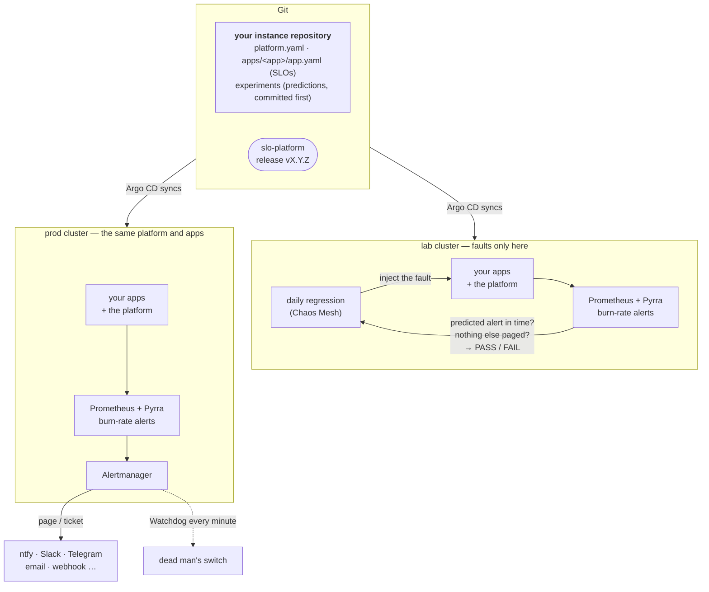

# slo-platform

SLOs you can trust. Declare service level objectives next to your application, get multi-window burn-rate alerts,
and **prove those alerts work**: a fault experiment library runs every day on a lab cluster and checks that each alert
fires when it should — and that normal traffic pages nobody.

A real run on a fresh kind cluster, replayed with the waits compressed (`docs/demo/`).

> **Status: v0.2.0 (alpha).** Install from one `platform.yaml`: `slo-platform init` creates your instance repository,
> `bootstrap/tofu` installs a released version into kind or an existing cluster, notifications go to ntfy / Slack /
> Telegram / email and more, and CI instantiates the template end to end with a passing fault experiment. Start with
> [docs/quickstart.md](docs/quickstart.md); what's next: [docs/roadmap.md](docs/roadmap.md).

## Quickstart

[docs/quickstart.md](docs/quickstart.md): `slo-platform init`, push, `tofu apply` on kind, and the first fault
experiment proves that an outage pages in time — about 30 minutes, most of it waiting.
`scripts/e2e.sh` runs the same path unattended (CI: weekly and on every release).

## Why

SLO tools generate alert rules (Pyrra, Sloth). Nothing tells you whether those rules would actually fire during a real
outage — until the outage. An alert that has never fired is a hope, not a safety net. slo-platform closes the loop:

| Step | What you get |
|---|---|
| **Declare** | SLOs in your application's `app.yaml` — availability, latency, probe, freshness (age), ratio, bool — one declaration for every environment |
| **Alert** | Multi-window, multi-burn-rate alerts (page / ticket), "SLI absent" tickets, sensible routing and inhibition |
| **Verify** | Fault experiments with predictions committed before the run (which alert fires within how long, what stays quiet), run daily as a regression on a lab cluster; a negative test proves normal traffic pages nobody |
| **Gate** *(planned)* | Error budget left decides whether a promotion to prod needs a reason, or only fixes may ship — today the budgets are there (Pyrra); the promotion gate itself is not part of the platform yet (the reference installation runs one from its private delivery board) |
| **Size** | Capacity tests judged on the same SLOs: raise the load until one stops holding — the knee, req/s per pod, what ran out first, how long the autoscaler takes ([docs/capacity.md](docs/capacity.md)) |
| **Watch the watcher** | External probes from outside the cluster and a dead man's switch for the alerting pipeline itself |

## How it works

- You install the platform into your clusters from a **versioned release** and keep only your own configuration in
  your own repository: one `platform.yaml` (see [platform.example.yaml](platform.example.yaml)) and one `app.yaml`
  per application. Upgrading = changing the version.
- The **same** platform and applications run on both clusters. Faults only ever go to the lab (its nodes must carry
  `slo-platform/lab=true`, or the runner refuses): an alert that fires there fires the same way in prod.
- Under the hood: Argo CD (GitOps), kube-prometheus-stack, Pyrra (SLO rules), blackbox exporter, Chaos Mesh, k6.

## Reference installation

slo-platform runs the maintainer's own two k3s clusters: `laptop` (prod) and `lab` (fault experiments and the daily
regression).

| Repository | Role |
|---|---|
| [gitops-manifests](https://github.com/MIERAI/gitops-manifests) | The live instance repository: its [`platform.yaml`](https://github.com/MIERAI/gitops-manifests/blob/main/platform.yaml) and the applications, synced by Argo CD to both clusters |
| [infrastructure-live](https://github.com/MIERAI/infrastructure-live) | Bootstraps the clusters (OpenTofu, Ansible, SOPS) |
| [storefront](https://github.com/MIERAI/storefront), [sample-app](https://github.com/MIERAI/sample-app) | Source of the example applications; [`examples/`](examples/) deploys their images |
| [gitops-platform-blueprint](https://github.com/MIERAI/gitops-platform-blueprint) | The principles behind it, and the shared CI workflows (`build-image.yml`, `promote-dev.yml`) the example apps use |

The error-budget promotion gate of the reference installation lives in a private delivery board (not public).

## Layout

| Path | Contents |
|---|---|
| [`platform/`](platform/) | The platform's components (knows no application by name) |
| [`bootstrap/`](bootstrap/) | Getting a cluster to the point where Argo CD runs the platform; `init` creates your instance repository |
| [`experiments/templates/`](experiments/templates/) | Fault experiments per SLI type, generated for each declared SLO |
| [`examples/`](examples/) | `sample-app` (quickstart) and `storefront` (reference: dependency chain, async pipeline) |
| [`docs/`](docs/) | Concepts, quickstart, configuration reference, runbook |

## Project status and support

slo-platform is an **alpha**, maintained by one person in their spare time, on a best-effort basis: issues and pull
requests are welcome and read, without a response time promise. It runs the maintainer's own two clusters (prod and
lab) on released versions; the end-to-end test instantiates it from scratch every week. Breaking changes are possible
before 1.0 and are written in [CHANGELOG.md](CHANGELOG.md) with an upgrade note. Security issues: [SECURITY.md](SECURITY.md).

## License

[Apache-2.0](LICENSE)
